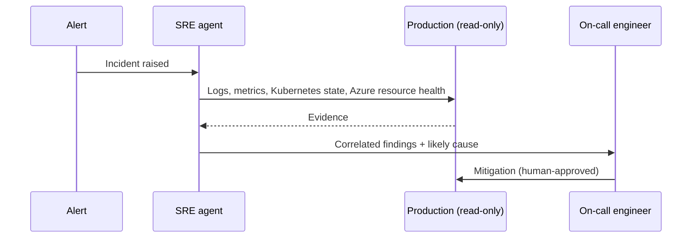

On my services, an autonomous SRE agent is now the first responder on every incident.
Before a human has opened a laptop, the agent has already pulled the logs, metrics,
Kubernetes state and Azure resource health, correlated them and posted what it found.
Since we made that change, our time-to-mitigate is down **80%**.

The agents run on [Azure SRE Agent](https://learn.microsoft.com/azure/sre-agent/) with
production **read** access. That last word is doing a lot of work, and most of this post
is about why.

## Skills vs agents

It helps to separate two ideas:

- A **skill** is a focused, reusable capability: how to query our logs for a service,
  how to read pod state in a cluster, how to check Azure resource health. It's written
  like a runbook step, with clear inputs and outputs.
- An **agent** combines skills toward a goal, like "figure out why error rates spiked on
  this service", and decides which skills to use and in what order.

Six teams now use the skill and agent practices I established. The short version: write
skills like you'd write a runbook for a new on-call engineer, and keep agents narrow.

**[TODO: The concrete practices. For example, skill structure and naming, how skills
are shared and versioned across teams, and what makes a good vs bad skill.]**

## Why read access only

An agent that can read production can investigate. An agent that can write to
production can make an incident worse at machine speed. For first response, almost all
of the value is in the investigation: gathering evidence and narrowing down the cause
faster than a half-awake human can.

So the agents can look at everything they need and change nothing. Mitigation actions
stay with a human.

**[TODO: How access is scoped in practice, at whatever detail is OK to share. For
example, RBAC roles, which resources and data are in or out of scope, how secrets and
PII are handled, and how agent activity is audited.]**

## What the first response looks like

**[TODO: Walk through a real (sanitized) incident: what fired, what the agent found and
how quickly, and what the human did with it.]**

## Earning trust

Nobody trusts a new on-call engineer on day one, and an agent shouldn't get that trust
either.

**[TODO: How you built confidence. For example, running the agent in shadow mode
alongside humans, how you checked its findings, how you evaluate it over time, and what
happens when it's wrong.]**

## What went wrong

**[TODO: Honest failure modes. For example, confident wrong answers, noisy telemetry,
missing context, skills that were too broad, and what you changed as a result.]**

## What on-call looks like now

Time-to-mitigate is down 80% on my services. **[TODO: Comparison window, e.g. versus
the N months before.]** The bigger change is how on-call feels. Instead of starting
from a blank dashboard, the on-call engineer starts from a summary of evidence and a
likely cause, and spends their time deciding and acting.

**[TODO: How the on-call experience changed for the team, and what you'd let agents do
next, if anything, beyond read access.]**

## If you want to try this

**[TODO: Your top takeaways. Candidates: start read-only, write skills like runbooks,
keep agents narrow, shadow before you trust, and keep humans on every mitigation.]**

## Feedback

Running agents against production yourself? I'd like to compare notes. Find me on
[GitHub](https://github.com/Harley-Adams) or [LinkedIn](https://www.linkedin.com/in/harleyadams/).
