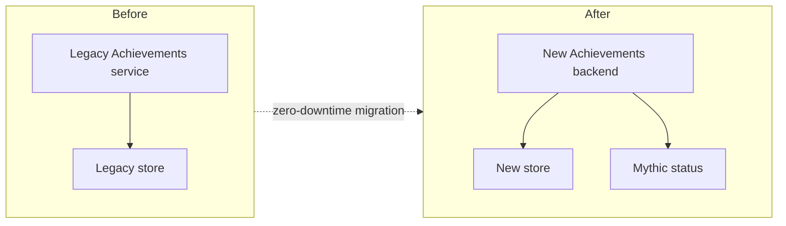

On October 28, 2026, [Mythic Achievements](https://news.xbox.com/en-us/2026/09/29/xbox-insiders-october-2026-console-features-4/)
rolled out to every Xbox player as the
[headline feature of the October console update](https://www.purexbox.com/news/2026/10/xbox-adds-10-new-features-in-october-28th-update-now-available-to-download).
The idea is simple. Finish every original achievement in a game and that game reaches
Mythic status. It counts retroactively, all the way back to Xbox 360, and you keep it
even when DLC adds new achievements later.

Simple for players. Under the hood, it meant rewriting the Achievements backend while
it was serving live traffic, and then working out Mythic status for more than
**1 billion players across more than 16,000 titles**. We did all of that with zero
downtime.

I was the lead engineer on a 12-person working group spanning product, client
engineering and services. We also built it AI-native: AI reviewed our designs and plans
before anyone wrote code, and GitHub Copilot generated 100% of the committed code. This
post covers what that looked like, what worked and what I'd do differently.

## The deceptively hard definition

The first problem wasn't technical. It was "what does *finished* mean?"

A game's achievement list isn't fixed. Developers add DLC packs, title updates and
sometimes whole new achievement sets years after launch. If Mythic meant "every
achievement currently in the game", players would lose Mythic status every time a
studio shipped DLC. That's the opposite of what a prestige feature should do.

So Mythic is defined against a game's **original** achievement list: the base list,
separate from add-ons. Once you've earned everything in it, you're Mythic for good.
That one product decision ended up shaping the data model, the backfill and the
consistency guarantees.

**[TODO: How you identified the "original" list for 16,000+ titles, especially older
titles where base and DLC achievements weren't cleanly separated in the data. Any
edge cases (title updates, re-releases, backward-compatible titles) and how you settled
them with product.]**

## Why a rewrite, and not a feature on the old service

**[TODO: What the legacy Achievements backend looked like and why it couldn't take
Mythic as-is: data model, storage, coupling, operational cost. Keep it to what's OK to
say publicly.]**

**[TODO: Replace the placeholder diagram with the real old-vs-new shape, at whatever
level of detail is OK to publish.]**

If you've read [I Picked the Wrong Partition Key So You Don't Have To](/thoughts/i-picked-the-wrong-partition-key/),
you know I care a lot about getting the data layout right before traffic shows up.
**[TODO: How partitioning and data-model choices in the new backend were informed by
lessons from the legacy service.]**

## Backfilling a billion players without anyone noticing

The backfill was the riskiest part of the project. Every player, every title, all the
way back to Xbox 360, computed against the original achievement list. And all of it had
to happen while the existing service kept serving live traffic.

The constraints we held ourselves to:

- **Zero downtime.** Players unlocking achievements during the backfill had to see
  correct results, and the live service couldn't notice the extra load.
- **Correct, not just eventually there.** A wrong Mythic badge on someone's profile is
  very visible, so we had to be able to prove the backfill matched the source of truth.
- **Restartable.** At this scale something will fail partway through. Resuming had to be
  boring.

**[TODO: How you actually did it. For example: how work was partitioned and throttled
to protect the live service, how live unlocks during the backfill were reconciled,
how you validated correctness, how long it ran, and the scariest moment.]**

## Building it AI-native

This is the part I get asked about most. "GitHub Copilot generated 100% of the committed
code" sounds like a stunt, so here's what it actually meant.

**Humans owned the decisions. AI did the typing and a lot of the checking.** The working
group still owned architecture, the data model, rollout and every merge. What changed
was where our time went.

### AI reviewed designs and plans before coding started

Before implementation, each design and plan went through AI review. We asked it to look
for gaps: missing failure modes, unclear ownership, steps that didn't follow from the
design, and places where the plan contradicted itself. It's cheap to fix a plan and
expensive to fix a backfill that's halfway through a billion players.

**[TODO: A concrete example of a gap the AI review caught in a design or plan, and one
thing it got wrong or missed.]**

### Copilot generated every line we committed

Engineers worked from the reviewed plan and had Copilot generate the implementation.
Then they reviewed, rejected, re-prompted and tested until it met the bar. Nobody
hand-wrote committed code. The skill shifted from typing code to specifying it
precisely and reviewing it hard.

**[TODO: What made this work in practice. For example, how plans were sized so
generations stayed reviewable, repo instructions or skills you relied on, how you
handled tests, and where Copilot struggled.]**

### What I'd tell another team

**[TODO: Your honest take. Suggested prompts: what sped up the most, what didn't
speed up at all, what you'd do differently, whether you'd go 100% again.]**

## Shipping it

Mythic Achievements went to Xbox Insiders in late September and reached every player
with the October 28 update. **[TODO: Anything notable from the rollout: flighting
approach, player reaction, a favorite community moment.]**

**[TODO: Closing thought in your own words: what this project showed about building
AI-native on a high-stakes, zero-downtime migration.]**

## Feedback

Questions about the backfill, the definition problem or the AI workflow? Find me on
[GitHub](https://github.com/Harley-Adams) or [LinkedIn](https://www.linkedin.com/in/harleyadams/).
